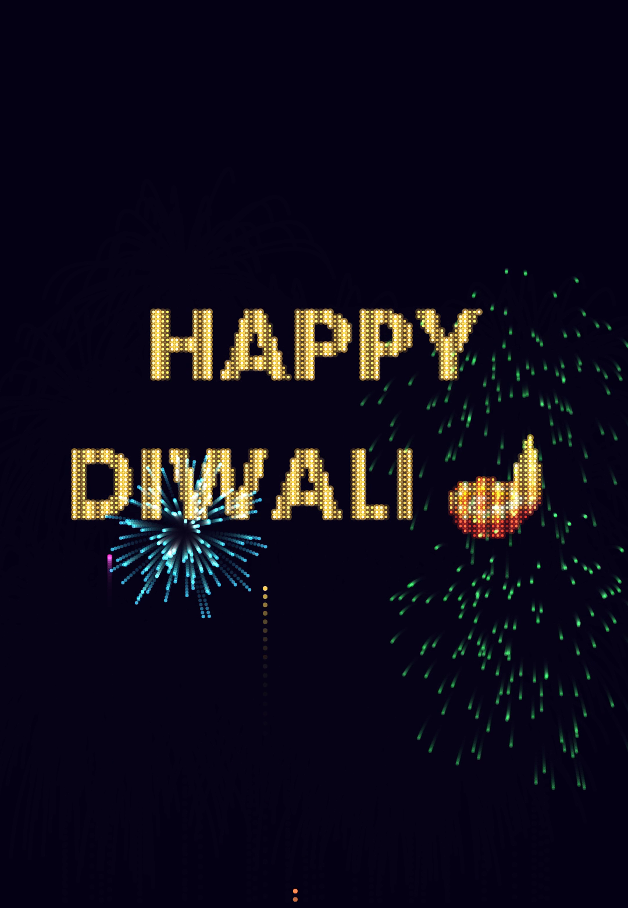

# 🎆 Happy Diwali Fireworks in JavaScript

Rockets rise, burst into colorful sparks with gravity and fade, and then one big rocket explodes and **every spark flies home to a pixel of “HAPPY DIWALI 🪔”**. Plain HTML canvas + vanilla JavaScript, no libraries.

**Day 9 of the 100 Days Daily Reel Challenge by [@hack.n.code](https://www.instagram.com/hack.n.code/)**

## Files

| File | What it does |
|---|---|
| `index.html` | The page: a 1080×1560 canvas and the two scripts |
| `fireworks.js` | Canvas setup, `textPoints()` (samples the text pixels) and the animation `loop()` |
| `particles.js` | `launch()` rockets, `burst()` sparks, `dot()` drawing and `move()` physics |

## How it works

1. **Text to points.** `textPoints()` draws “HAPPY / DIWALI 🪔” on an offscreen canvas, reads it back with `getImageData`, and keeps every 8th pixel that is filled, with its color.
2. **Rockets.** A rocket launches every 30 frames with a random speed and slows down under gravity. At the top (when `vy > -1`) it bursts.
3. **Sparks.** Normal sparks get a random angle and speed, fall with gravity, and fade out over 80 frames.
4. **The big one.** At frame 240 a big rocket launches from the center. Its burst makes one spark per text point, and each spark eases toward its target (`(target - pos) * k`), so the explosion gathers into the words and twinkles.
5. **Glow + trails.** Each frame paints a translucent dark rectangle (trails) and draws sparks with `globalCompositeOperation = 'lighter'` (glow).

## Run it

Open `index.html` in a browser, or with VS Code Live Server / `npx live-server`.

Try changing the text in `textPoints()` to your own message ✨

## License

MIT, free to use and remix. Tag @hack.n.code if you post it! 🪔
